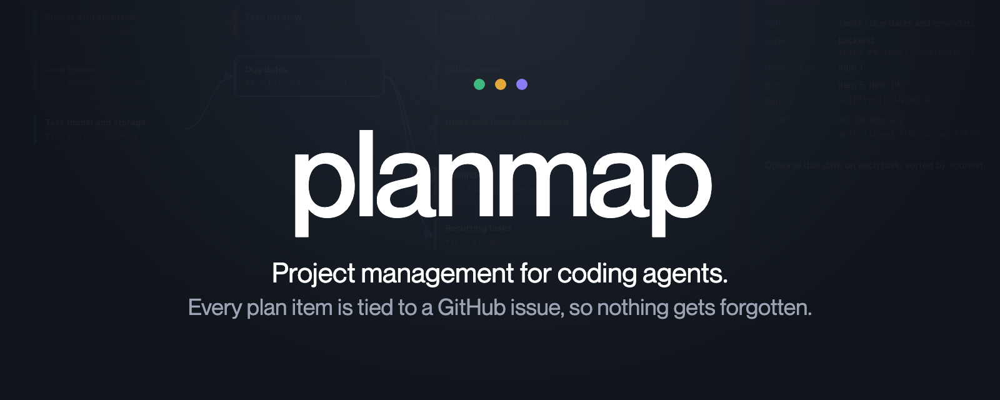
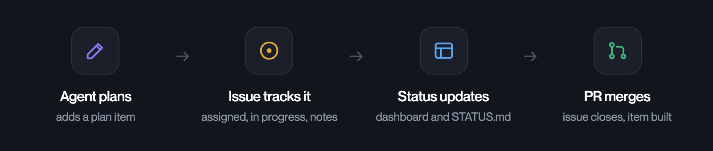
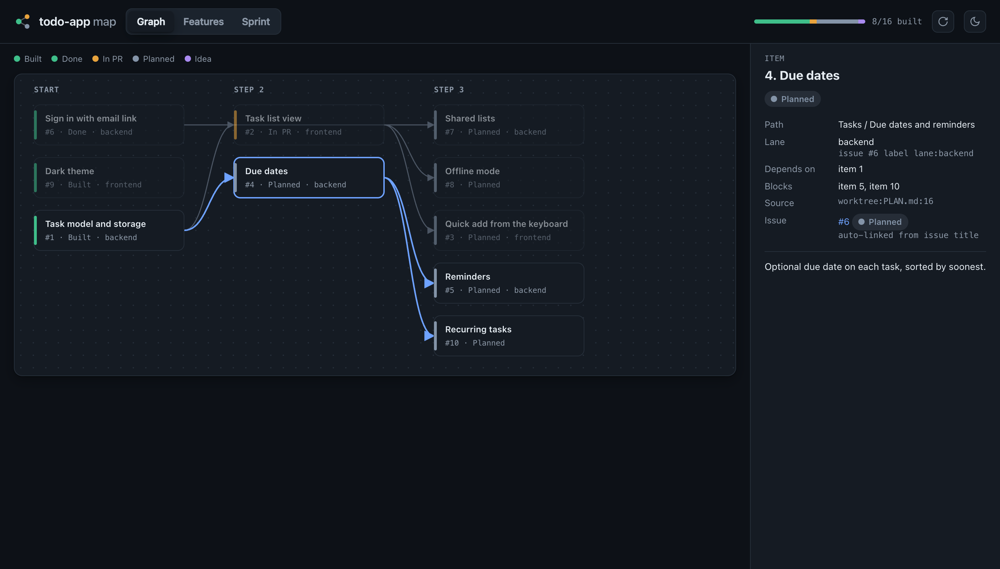
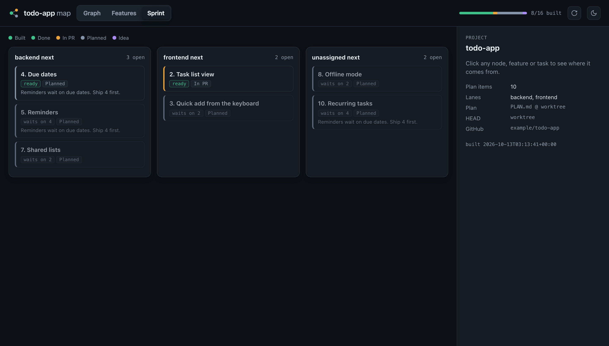

<p align="center">
  
</p>

<p align="center">
  
</p>



Coding agents are fast, but they lose track. planmap gives your agent a project plan it has to keep current, and your agent keeps your GitHub issues up to date. Each plan item gets its own issue. When the agent starts an item, the issue is assigned and labelled in progress. Notes land on the issue as it works, and the PR closes it. The local dashboard and a `STATUS.md` file show what is in progress, what is blocked and what to do next.

## Quickstart

```sh
pipx install git+https://github.com/patrickt6/planmap   # needs Python 3.9+ and the gh CLI
cd your-repo && planmap init --skill                     # writes .planmap/, PLAN.md and the Claude Code skill
planmap open                                             # builds the dashboard and opens it in the browser
```

To try it without a repo of your own, run `planmap --root examples/todo-app open` from a clone.

## How it works

- In the plan file, each item is a `### N. Title` heading. Add `Depends on: 2, 4` when it waits on other items.
- `.planmap/taxonomy.json` sorts items into pillars and features, and can point at the files that carry each feature.
- On GitHub, an issue or PR titled `[item N] ...` links to item N on its own. A `lane:<name>` label puts the item in that lane.

| Command | What it does |
|---|---|
| `planmap start N` | assigns item N's issue to you, labels it `status:in-progress` and comments the branch |
| `planmap progress N "note"` | adds a note to the issue |
| `planmap done N --pr P` | adds `Fixes #<issue>` to PR P and clears the in-progress label |
| `planmap sync --dry-run` | shows how plan item text would be copied into issue bodies; drop `--dry-run` to write. Only the part between planmap's markers changes |
| `planmap sprint` | prints "<lane> next" for each lane: ready items first, blocked ones marked |
| `planmap doctor` | finds orphan features, phantom numbers or paths, and unsorted items. Exits 1 on drift, so it works as a CI gate |
| `planmap add "Title" --feature F --issue --lane L` | adds the plan item, files it under the feature, and opens the `[item N]` issue |
| `planmap build` | rebuilds the dashboard data and writes `.planmap/STATUS.md`, a plain summary meant to be committed |

The plan heading regex, the item tag and the lane prefix can all be changed in `.planmap/config.json`.

## What the agent does

`planmap init --skill` writes `.claude/skills/planmap/SKILL.md`. You can also add it as a plugin with `/plugin marketplace add patrickt6/planmap`. With the skill loaded, Claude Code will:

1. read `.planmap/STATUS.md` when a session starts and pick the first ready item in its lane,
2. use `planmap add ... --issue` for each new spec, so the plan item and its issue are created together,
3. run `planmap start`, `planmap progress` and `planmap done` as it works, so the issue always shows where things stand,
4. run `planmap doctor` before it finishes, and fix any drift it reports.

`planmap init --hooks` prints a Claude Code SessionStart hook. Add it to `.claude/settings.json` and every session starts with a one line status per lane.



planmap only writes to GitHub when you or the agent run `start`, `progress`, `done`, `sync` or `add --issue`. It needs no token beyond `gh auth login`. Only use it if you keep a written plan. If the plan lives only in issues, use GitHub Projects.

## License

MIT
